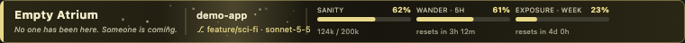
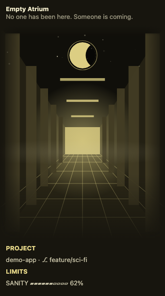
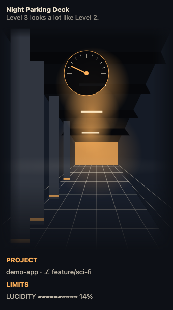
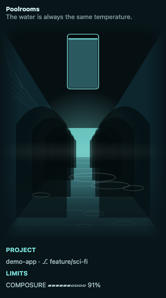
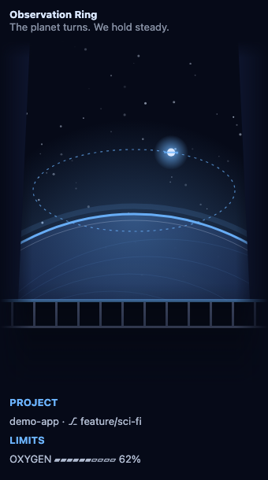
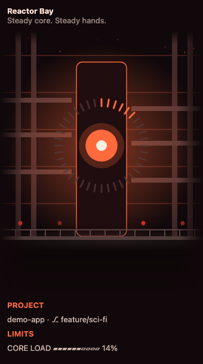
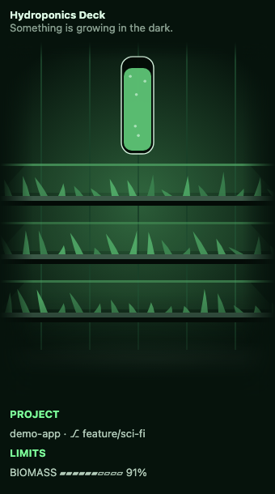
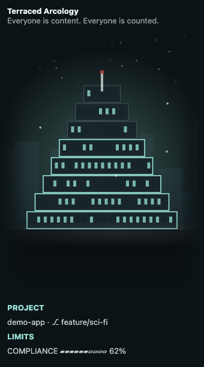
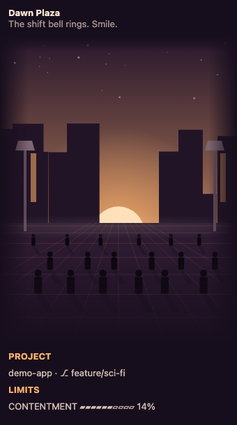
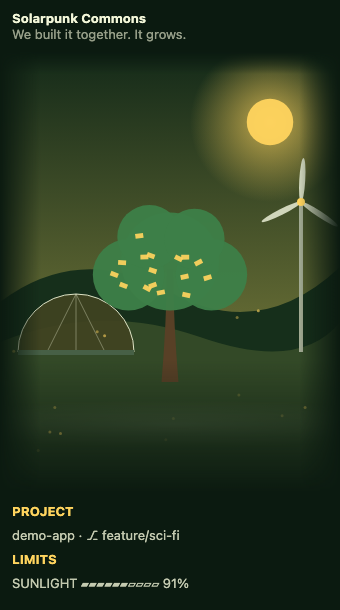

# control-station

A science-fiction control deck for Claude Code, written as a mod. It draws an animated banner above the prompt and a side panel beside the chat, both in the colours of the scene you pick. It works in the Claude desktop app. There is no music and nothing is downloaded.

## What you get

- **Banner:** a slim animated strip above the prompt with the scene name and motto, the project, git branch and model, and gauges for context used, the 5-hour limit and the weekly limit, each with its reset time. A limit the session does not report is left out, and today's counts take its place. It has no buttons: open the panel with `/cs open`, pause the animation with `/cs toggle animation`, shuffle the scene with `/cs scene random`, and hide the banner with `/cs toggle bar off`.
- **Side panel:** the mode and scene dropdowns, then the scene filling the panel with no frame and the text written over it: the context gauge in the corner (drawn into the art too), the scene's name and motto, the project (branch, uncommitted changes, ahead and behind, last three commits), limits as progress bars, and today's counts. Quick actions sit below.
- **One typeface per mode:** Liminal space uses Helvetica Neue, Space station uses SF Mono and Utopia uses Optima. Every scene follows its mode. They are system fonts, so nothing is downloaded; the panel's plain text lines keep the app's own font.
- **Nine scenes in three modes:**

| Mode | Scenes |
|---|---|
| Liminal space | Empty Atrium, Night Parking Deck, Poolrooms |
| Space station | Observation Ring, Reactor Bay, Hydroponics Deck |
| Utopia | Terraced Arcology, Dawn Plaza, Solarpunk Commons |

Each scene has its own palette, motto and gauge names. Each mode remembers the scene you last chose.

## Install

```
/plugin install control-station --marketplace wends05/control-station
```

Needs Claude Code 2.1.275 or later.

## Previews

The banner and the side panel for each scene:

**Empty Atrium**





**Night Parking Deck**




**Poolrooms**




**Observation Ring**




**Reactor Bay**




**Hydroponics Deck**




**Terraced Arcology**




**Dawn Plaza**




**Solarpunk Commons**




## Commands

`/control-station` or `/cs`:

| Command | What it does |
|---|---|
| `/cs toggle <part>[,<part>…] [on\|off]` | Turn parts on or off: `bar`, `panel`, `background`, `animation`, `project`, `limits`, `today`, `files`, `actions` |
| `/cs mode <liminal\|station\|utopia>` | Switch mode |
| `/cs scene <name\|next\|random>` | Switch scene |
| `/cs open` · `/cs close` | Open or close the side panel |
| `/cs status` · `/cs reset` | Show the settings, or restore the defaults |

Settings are kept in the mod's store, so every chat and project shares them.

## Setup while developing

Add the folder to `CLAUDE_CODE_PLUGIN_DIRS` in `~/.claude/settings.json`, with `CLAUDE_CODE_PLUGIN_DIR_WATCH` set to `1`, so saving a file reloads the mod:

```json
{
  "env": {
    "CLAUDE_CODE_PLUGIN_DIRS": "/absolute/path/to/control-station",
    "CLAUDE_CODE_PLUGIN_DIR_WATCH": "1"
  }
}
```

Separate several folders with `:`.

## Develop

```bash
claude plugin validate .
claude plugin test .
```

`hooks/register.tsx` holds the hooks, `hooks/art.ts` draws every scene and the banner, `hooks/scenes.ts` lists the scenes, and `types/index.d.ts` declares the mod's state. `previews/` holds a PNG of each scene's panel and banner.

## License

[MIT](LICENSE)
